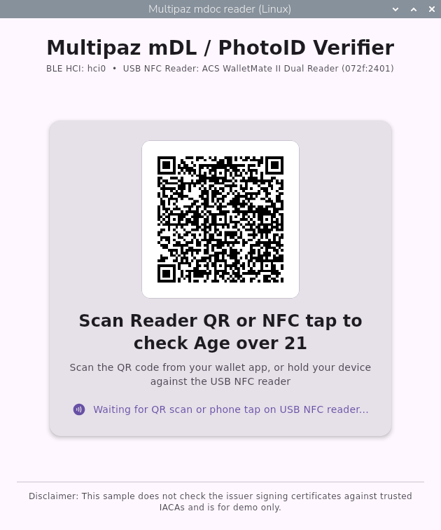

# IsoMdocReaderLinux

A Linux Desktop (JVM) sample application for reading ISO/IEC 18013-5 mdocs (such as Mobile Driving Licenses and PhotoIDs) using:
- **`multipaz-bthci`** (`BtHciMdocTransportFactory`) for BLE transport over a Linux Bluetooth HCI controller (`HCI_CHANNEL_USER`).
- **`NfcTagReaderUsb`** for NFC engagement and data transfer using a USB-connected CCID NFC reader.

## Screenshots

| Waiting for NFC Tap | Verification Result |
| :---: | :---: |
|  |  |

## What It Does

1. Displays a window showing an ISO/IEC 18013-5 Second Edition **Reader QR code** while simultaneously polling the USB NFC reader for an **NFC tap**.
2. Engages over whichever channel the holder uses first:
   - **Reader QR** (reverse engagement over BLE via `multipaz-bthci`), or
   - **NFC tap** (supporting both ISO/IEC 18013-5 Second Edition NFC CCE and NFC Negotiated/Static Handover over BLE or NFC).
3. Sends a `DeviceRequest` for either `org.iso.18013.5.1.mDL` (mDL) or `org.iso.23220.photoid.1` (PhotoID) using `UseCase` / `DocumentSet`, requesting:
   - `portrait`
   - `age_over_21` OR `age_in_years` OR `birth_date` (using `AlternativeDataElementSet`)
4. Verifies the `DeviceResponse` (MSO signature, digests, validity dates, and device authentication) and displays:
   - The holder's `portrait`
   - Either **"This person is older than 21"** (with a green border) or **"This person is not older than 21"** (with a red border)
   - A disclaimer noting that the sample does not check issuer signing certificates against trusted IACAs and is for demo purposes only.

## Prerequisites

- Linux with a Bluetooth HCI controller (e.g. `hci0` or a dedicated USB Bluetooth dongle `hci1`).
- *(Optional)* An external USB CCID NFC reader (e.g. ACS ACR1252U `072f:2200`, ACS WalletMate II `072f:2401`, Identiv uTrust 3700 F `04e6:5724`, etc.). The app works with Reader QR even when no USB NFC reader is attached and automatically detects USB NFC readers as they are hot-plugged or removed.
- `capsh` (`libcap2-bin` / `libcap`) and `setfacl` (`acl`).
- Multipaz `0.103.0-SNAPSHOT` published to local Maven (`~/.m2`).

## Running

Use the included `launch-with-hci` script, which builds the JVM application as your normal user, grants read/write ACL permission on connected/hot-plugged USB CCID NFC reader device nodes, and launches the JVM with ambient `CAP_NET_ADMIN` capability:

```bash
./launch-with-hci
```

You can also optionally specify a Bluetooth HCI controller (`--hci`, defaults to `hci0`) or filter for a specific USB NFC reader `VID:PID` (`--usb`):

```bash
./launch-with-hci --hci hci0 --usb 072f:2401
```
