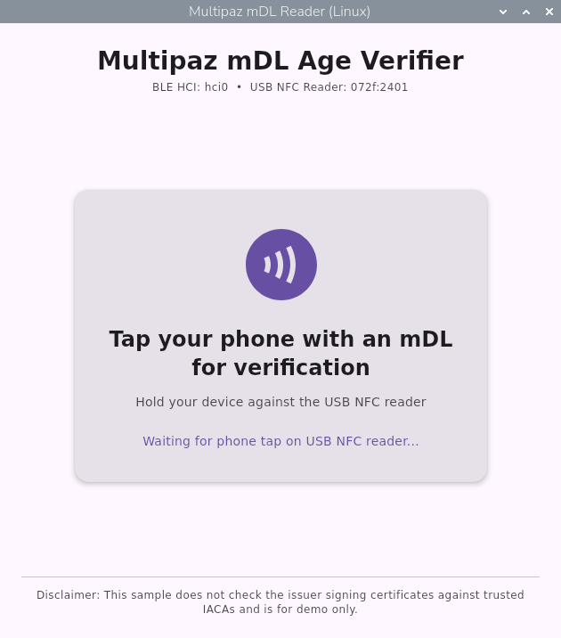
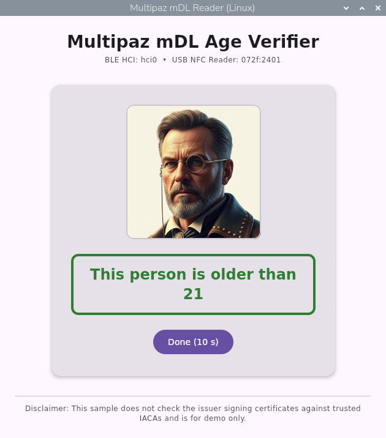

# MdlReaderLinux

A Linux Desktop (JVM) sample application for reading ISO/IEC 18013-5 Mobile Driving Licenses (mDLs) using:
- **`multipaz-bthci`** (`BtHciMdocTransportFactory`) for BLE transport over a Linux Bluetooth HCI controller (`HCI_CHANNEL_USER`).
- **`NfcTagReaderUsb`** for NFC engagement and data transfer using a USB-connected CCID NFC reader.

## Screenshots

| Waiting for NFC Tap | Verification Result |
| :---: | :---: |
|  |  |

## What It Does

1. Displays a window prompting the user to tap their phone with an mDL on the USB NFC reader.
2. Performs NFC engagement (supporting both NFC Negotiated Handover and ISO/IEC 18013-5 Second Edition NFC CCE) and connects over BLE or NFC.
3. Sends a `DeviceRequest` for `org.iso.18013.5.1.mDL` requesting:
   - `portrait`
   - `age_over_21` OR `age_in_years` OR `birth_date` (using `AlternativeDataElementSet`)
4. Verifies the `DeviceResponse` (MSO signature, digests, validity dates, and device authentication) and displays:
   - The holder's `portrait`
   - Either **"This person is older than 21"** (with a green border) or **"This person is not older than 21"** (with a red border)
   - A disclaimer noting that the sample does not check issuer signing certificates against trusted IACAs and is for demo purposes only.

## Prerequisites

- Linux with a Bluetooth HCI controller (e.g. `hci0` or a dedicated USB Bluetooth dongle `hci1`).
- An external USB CCID NFC reader (e.g. ACS ACR1252U `072f:2200`, ACS WalletMate II `072f:2401`, Identiv uTrust 3700 F `04e6:5724`, etc.).
- `capsh` (`libcap2-bin` / `libcap`) and `setfacl` (`acl`).
- Multipaz `0.103.0-SNAPSHOT` published to local Maven (`~/.m2`).

## Running

Use the included `launch-with-hci` script, which builds the JVM application as your normal user, grants read/write ACL permission on the USB NFC reader device node, and launches the JVM with ambient `CAP_NET_ADMIN` capability:

```bash
./launch-with-hci --hci hci0 --usb 072f:2401
```

If `--hci` is omitted, it defaults to `hci0`. If `--usb` is omitted, it auto-detects the first connected USB CCID NFC reader:

```bash
./launch-with-hci
```
